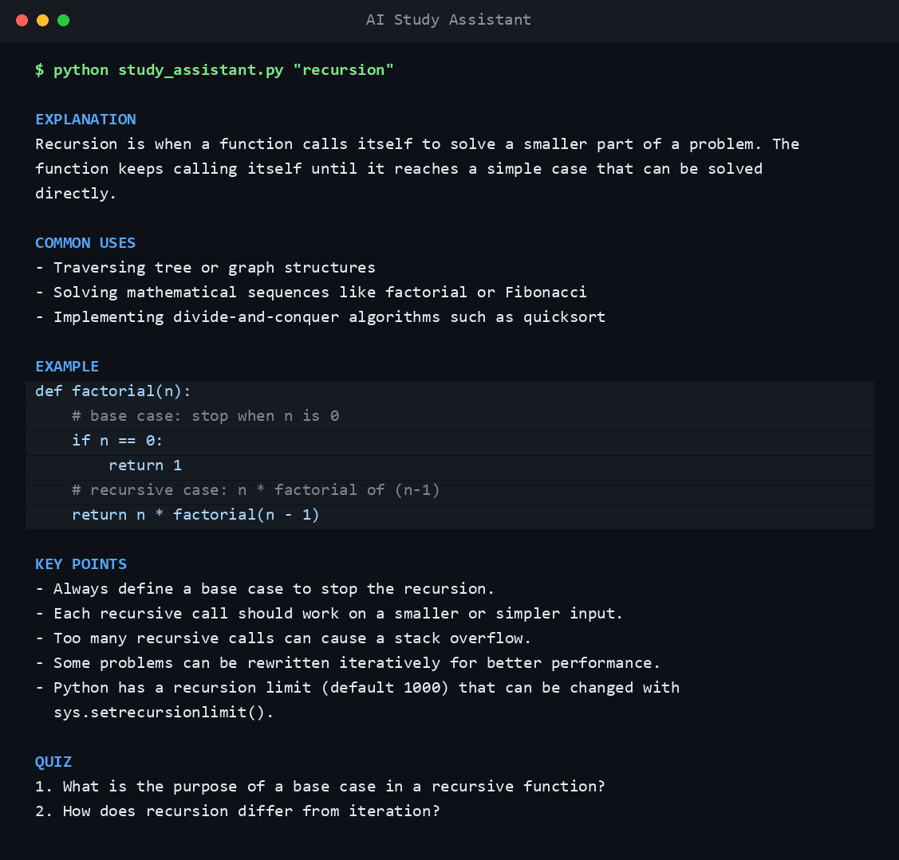
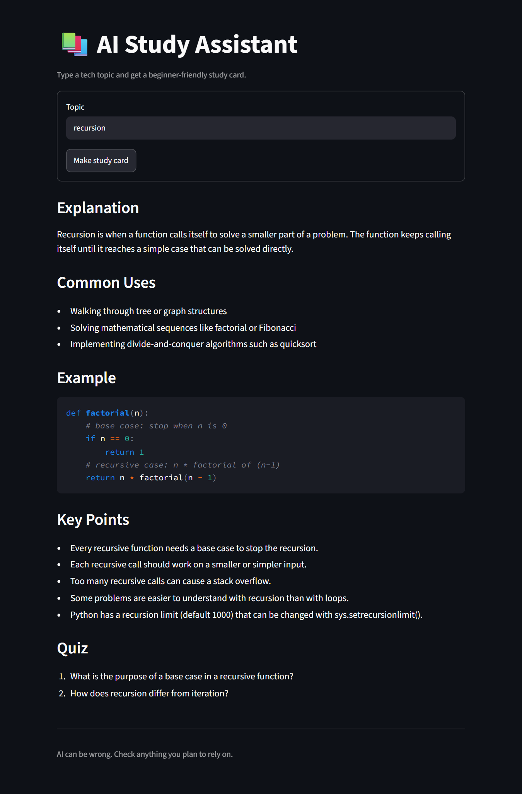
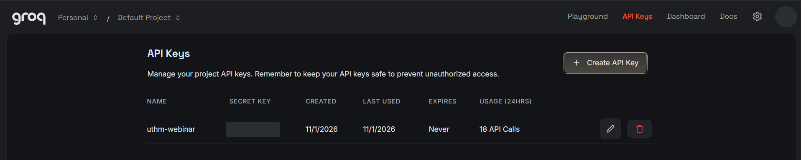

# AI-Powered Python: REST APIs, Prompting and a Study Assistant

My hands-on practice repo from the UTHM CodeVerse Week 2 workshop, "AI-Powered Python". It goes from calling a plain REST API, to trying four prompting techniques, to a small command-line app that turns any tech topic into a beginner-friendly study card.

This is based on the mini project from the UTHM CodeVerse Week 2 workshop (AI-Powered Python) by Rynet Malaysia. The workshop slides and example code are theirs and are not included here; this code is my own implementation.



There is also a small web version built with Streamlit:



## What's inside

| Folder / file | What it does |
|---|---|
| `rest_api/` | Three small exercises against the free [JSONPlaceholder](https://jsonplaceholder.typicode.com) API: list users (GET), check a to-do (GET), post a comment (POST). No key needed. |
| `prompting/` | The same Groq call used four ways: zero-shot, system role, few-shot and chain-of-thought. |
| `study_assistant.py` | The main app. Type a topic, get a study card. |
| `app_streamlit.py` | The same study assistant as a simple web page (Streamlit). |
| `extras/batch_cards.py` | Make cards for many topics at once, save them to JSON, and optionally POST them to JSONPlaceholder. |
| `groq_client.py` | Shared helpers: loads the key, calls the model, and turns common errors into friendly messages. |

## The study card

For each topic you get five parts: **Explanation** (2-3 simple sentences), **Common Uses**, a short commented **Example**, 3-5 **Key Points**, and 2-3 **Quiz** questions. The prompt lives in one function, `build_messages()` in `study_assistant.py`, so it is easy to change.

It uses the Groq API with the open-weight `openai/gpt-oss-120b` model. Friendly messages (not tracebacks) are shown for a missing key, no internet, a rejected key, and rate limits (HTTP 429).

## Requirements

- Python 3.10 or newer
- A free Groq API key from the [Groq console](https://console.groq.com)

## Setup (Windows PowerShell)

```powershell
python -m venv .venv
.\.venv\Scripts\Activate.ps1
pip install -r requirements.txt
Copy-Item .env.example .env
```

Open `.env` and put your key after `GROQ_API_KEY=`.

To get a key, sign in to the Groq console, open **API Keys** and click **Create API Key**. Here is mine after a few test runs (the key itself is hidden, and yours should stay private too):



## Run

Run everything from the repo root.

```powershell
# the study assistant (interactive; type quit to leave)
python study_assistant.py

# or one topic straight away
python study_assistant.py "REST API"

# REST exercises (no key needed)
python -m rest_api.list_users
python -m rest_api.check_todo
python -m rest_api.post_comment

# prompting techniques (need the key)
python -m prompting.zero_shot
python -m prompting.system_role
python -m prompting.few_shot
python -m prompting.chain_of_thought

# several topics at once, saved to cards.json, also POSTed to JSONPlaceholder
python -m extras.batch_cards --topics "recursion" "REST API" --post
```

### Web version (optional)

```powershell
pip install -r requirements-web.txt
streamlit run app_streamlit.py
```

Then open the local address Streamlit prints (usually http://localhost:8501). It uses your key from `.env`, so only run it on your own machine and don't share the address.

If you hit a rate limit, wait a few seconds and try again. Free-tier limits can change, so check the Groq docs if something looks off.

## Example output

Real output from `python study_assistant.py "recursion"`:

```text
EXPLANATION
Recursion is when a function calls itself to solve a smaller part of a problem. The function keeps calling itself until it reaches a simple case that can be solved directly.

COMMON USES
- Traversing tree or graph structures
- Solving mathematical sequences like factorial or Fibonacci
- Implementing divide-and-conquer algorithms such as quicksort

EXAMPLE
def factorial(n):
    # base case: stop when n is 0
    if n == 0:
        return 1
    # recursive case: n * factorial of (n-1)
    return n * factorial(n - 1)
...
```

More runs are in [docs/screenshots](docs/screenshots). The model's answers vary a little each time, and AI output can be wrong, so double-check anything you plan to rely on.

## Security notes

- Never commit `.env`. It is already in `.gitignore`; only `.env.example` (with no key in it) is tracked.
- Keep your key private: don't paste it into chats, screenshots or issues.
- If a key ever leaks, delete it in the Groq console and create a new one.

## License

MIT. See [LICENSE](LICENSE). The license covers the code in this repo only; the workshop slides and example code belong to Rynet Malaysia.
